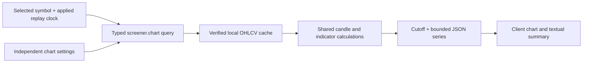

# Historical screener charts

Status: implemented, 2026-10-04 (uncommitted). See Implementation notes at the end. User selected a full-width chart below results, independent chart controls initialized from the screen, EMA rather than SMA, separate EMA 9/20/200 toggles, and regular-hours daily candles with shorter history. On 2026-10-04 the user also accepted the three open proposals: the EMA correction applies to screening as well as charts (a numerical change that can move instruments between match and no-match), the selector offers 1m/5m/10m/15m/30m/1h/Daily, and chart EMA/RSI lines follow the candle interval by default with an explicit fixed-timeframe override.

## Goal and first release

Select a screener result, inspect its recorded price action and volume, and compare chart indicators with the conditions that produced the result. Research stays attached to the selected instrument as the applied replay clock or screen changes.

The first release targets the verified AAPL, MSFT, NVDA, SPY and IWM sample with one-minute, ten-minute and regular-session daily candlesticks, volume, individually switchable EMA 9/20/200 lines, optional Wilder RSI, crosshair, pan/zoom and Reset view. Additional accepted candle presets are five minutes, fifteen minutes, thirty minutes and one hour. All chart intervals aggregate existing validated minute bars and need no new download, database table, provider key or subscription. The accepted coordinated scope replaces existing SMA filters/labels/calculations with EMA as well; this is a numerical change, not a label rename.

The user chose regular-session daily candles aggregated from EQUS.MINI minute bars, accepting the roughly six-week history. Require every expected session minute; a gap makes the daily slot unavailable. Chart EMA/RSI, including fixed daily overlays, use this same regular-session chart data. Do not fill short history with another feed. Daily EMA 200 is unavailable until enough consecutive daily history exists; valid daily candles remain usable.

Daily view and chart daily indicators exclude the replay session, even at 16:00, under the proposed conservative prior-session policy. Existing daily screen indicators currently use SUMMARY; the planned EMA correction need not silently change that source contract. Initialization copies periods/timeframes, while chart legends state the regular-session MINI basis and the context summary states the screen's actual source. Daily values may differ or chart warmup may be unavailable; do not promise equality across feeds/seed histories. Aligning the screener's daily source would require an explicit additional calculation-contract change.

The longer cached SUMMARY feed was considered but not selected for charts. It contains the final evening summary including post-market volume; its nominal session close is not proof of publication. Retain truthful source labels in existing screen context. Chart requests do not require that file. Longer regular-session daily history is a later download decision.

News panels, watchlists, saved screens, paper-trade actions, drawing tools, draggable panels, live refresh, new symbols and corporate-action adjustments belong to later increments. The outstanding-shares/public-float issue is separately recorded in the project review; charts must not depend on that filter or imply it has been repaired.

## Layout and selection

- The chart opens full-width below the results on desktop and mobile, as selected by the user. Use the available content width, not viewport width; the shell's sidebar and padding reduce usable space. Keep controls wrapping on narrow screens and avoid page-wide horizontal overflow.
- With no selection, show an invitation to select a symbol. Do not open the first match automatically.
- Make each symbol a named button such as "View NVDA chart", with visible keyboard focus and selected-row styling. Keep existing news links independently clickable. Match, no-match and excluded rows can all open price research.
- Panel header shows symbol, historical replay date/time in America/New_York, chart interval, latest completed candle and screen status. A no-match label lists failed conditions. An excluded status explains the screen exclusion without hiding usable candles.
- Selecting another symbol retains chart interval and indicator settings. Closing the panel clears selection; reopening starts from the preserved settings. Navigating away resets this page-only state. No persistence is introduced.
- A selected symbol survives Run screen, minute advancement, zero matches and filter changes. Keep research state outside the keyed ScreenForm/results subtree.

## Chart controls and screen context

The user selected independent chart controls initialized from the applied screen and separate EMA 9/20/200 toggles. Changing chart settings updates research immediately and never changes table membership or the filter draft. Accepted defaults let chart-native EMAs follow the candle interval while a screen-derived indicator retains its original explicitly labeled timeframe. The user accepted this indicator-following behavior on 2026-10-04.

- Candle interval selector: 1m, 5m, 10m, 15m, 30m, 1h and Daily. One minute, ten minutes and daily were requested first; the user accepted the other choices on 2026-10-04. Start with 1m. Candle interval affects candles and ordinary volume.
- Always show separate pressed-state buttons for EMA 9, EMA 20 and EMA 200; each can be switched on/off independently. Retain these choices when switching candle interval or stock. Turning one line off does not affect the other two, RSI or screen filters.
- New preset lines use the accepted "Chart interval" mode. EMA 20 on 10m uses twenty completed 10m candles; changing to 1m recalculates it from one-minute candles. Offer an explicit fixed-timeframe override rather than silently locking an ordinary preset to an old chart interval.
- Initial enabled indicators copy the screen's EMA/RSI periods and native timeframes. Activate a matching 9/20/200 preset; if its timeframe differs from initial 1m, initialize a labeled fixed override. Absent indicators start off; RSI 14 is available when enabled and volume starts on. A daily screen EMA remains daily, but chart calculations use regular-session MINI history. Explicitly identify that source difference in the legend/context and any warmup notice.
- Preserve editable EMA periods 1–200 with at most three active lines. The preset buttons remain available even if a custom period was copied from the screen; display that custom line separately within the same limit. Explain the limit when all three slots are in use. RSI has one on/off control, period 2–200, and Chart interval or a fixed timeframe. Validate controls on commit, not each incomplete keystroke.
- First selection initializes these defaults once. Subsequent screen changes do not overwrite chart exploration. Provide "Reset chart settings" to intentionally adopt defaults from the current applied screen.
- Show the applied screen's EMA/RSI values, thresholds, intervals and source/seed times in a separate textual context summary. Each chart legend includes its own interval and period. Promise numerical equality only for matching symbol, cutoff, indicator interval, period, feed and seed history; after independent edits the screen summary remains unchanged.
- Display volume as shares per candle. Relative volume remains the existing separate screen ratio; ordinary volume bars must not be labeled relative volume.
- Default intraday viewport shows the selected session through the cutoff. Return that prefix and four preceding replay sessions; missing slots count toward the hard 2,000-slot bound. Daily views return up to the last 250 expected eligible daily slots, initially showing the last 60 or all available if fewer. Never substitute observed candles for missing slots. Indicators calculate over earlier eligible history before display trimming; EMA 200 at an interval without enough consecutive candles is explicitly warming up/unavailable while prices remain usable.
- Switching symbol, interval or replay session resets the viewport. Advancing the same session preserves it; if it was following the right edge, keep following. Moving backward removes later data from the chart immediately. Reset view returns to the current session prefix.

## Candle and indicator contract

Internal prices remain integer billionths of a USD and volume remains integer shares. Preserve the already validated open/high/low/close/volume fields in the cache, keeping request manifests, byte counts, record counts and hashes unchanged.

| Rule | Required behavior |
| --- | --- |
| One-minute eligibility | Candle [10:29, 10:30) is available at 10:30; [10:30, 10:31) is unavailable. |
| Intraday aggregation | For 5m/10m/15m/30m/1h, anchor buckets at 09:30; use first open, maximum high, minimum low, last close and summed volume. Require every expected constituent minute. Clip the last bucket at session close; a shorter final bucket is eligible only when the session closes and its actual duration is labeled. |
| Interval completion | At 10:34, the latest 5m bucket ends 10:30; the one ending 10:35 appears at 10:35. On 10m, at 09:39 no bucket is complete; the first becomes available at 09:40. |
| Daily aggregation/source | MINI regular-day aggregates require the entire expected session; open first, high max, low min, close last, volume sum. Use only prior eligible sessions; no SUMMARY substitution or today's finalized daily bar. |
| Regular sessions | Include only expected session slots. Never aggregate across close/open, weekends or holidays. Overnight closures are not missing candles. |
| Missing minute | Preserve an explicit missing slot, not zero, a carried price, or a partially aggregated candle. Missing volume is not the same as zero observed volume. |
| EMA | Proposed FinWin contract: alpha = 2/(N+1). Seed at the mean of the first N consecutive completed closes, then `ema = ema + alpha * (close - ema)` for every subsequent close in the contiguous run. Period 1 equals close. A missing required candle resets the seed; require N new closes. Continue across valid session boundaries. |
| RSI | Existing Wilder recurrence and arithmetic order; N+1 closes to seed, reset at missing slots, flat value 50. Continue across valid session boundaries. |
| Warmup | Calculate over all eligible sample history first, then trim response slots. Panning or changing displayed range must not reseed EMA or RSI. |
| Availability | An unavailable indicator does not suppress valid candles or other indicators. Report warmup or gaps beside its control/legend. |
| Replay cutoff | Filter on candle completion before serialization. No future candle, high/low, volume, indicator point or tooltip reaches the client. |

Use a shared pure candle/indicator module for table and chart. Specify the EMA seed operation order: let `first` be the first integer close in the N-close seed, sum all N integer closes, calculate `base = Number(first) / 1e9`, calculate `offset = Number(sum - first * BigInt(N)) / N / 1e9`, then `seed = base + offset`. This is the arithmetic-mean seed expressed relative to its first price, preserving constant-price equality. For period 1, return each converted close directly. Use the declared double-precision recurrence without display rounding or a comparison epsilon.

Compare the latest converted price against the unrounded EMA with strict above/below; equality matches neither. This intentionally replaces SMA's finite-window BigInt comparison and may change membership. Keep other financial/price-range math unchanged. Verify sampled values against a Decimal oracle within 1e-9; verify screen membership separately, including equality and near-crossing cases rather than treating numeric tolerance as permission to change comparisons. Report seed history; identical periods alone do not guarantee another platform uses the same initialization.

EMA and RSI each use a single sequential calculation that emits points and the final scalar. Retain the existing RSI scalar interface where callers need it. Avoid recalculating an entire prefix per chart point. Daily indicator points exclude the current session even at 16:00, exactly as the screening policy does; the next regular session may use the preceding day's summary.

### Mixed-timeframe plotting

- Evaluate each EMA/RSI on its native expected candle sequence, including missing/warmup states, before projecting onto displayed candle slots.
- Resolve Chart interval mode to the selected candle timeframe; fixed overrides retain their chosen native timeframe. All chart indicators use regular-session MINI candles. At each displayed completion, select the latest eligible expected native state; slower values stay level between completions and never interpolate toward a later value.
- Daily values are eligible only in subsequent sessions under the proposed prior-session policy. Do not carry a day's finalized daily value at its own close. Daily lines stay level intraday and identify their regular-session source and through-date.
- Propagate the latest expected native state even when missing or warming up; do not skip it and carry an older valid value across a gap. A held value between native completions is not a fabricated missing candle.
- If an indicator is faster than the candle interval, plotted values sample at displayed candle completions. The latest native indicator summary may be newer than the last completed displayed candle; show both timestamps. Compare chart/table values at the same historical completion, not two different cutoffs.
- Carry a native contiguous-run identifier with projected points and gap-interruption metadata. A gap/reset may occur and recover between two displayed completions; valid sampled endpoints must not create a continuous line across that interruption. Split line segments at run changes and verify actual rendering. A seed timestamp alone should not hide a gap if the chosen period can recover quickly.
- The endpoint returns the final native state/value and seed provenance separately from plotted points. No native or projected value may depend on a candle completing after the replay cutoff.

Plot intraday slots by their UTC completion time. Tooltips show full New York start/end intervals and actual duration for shortened closing buckets. Daily candles use session-date labels, with nominal session close and source availability policy as separate metadata. Format New York labels without shifting stored UTC instants to the browser's timezone. Adapt chart-library time types only in the renderer.

Price and indicator lines must visibly break at missing points; candle/volume series retain whitespace slots. Verify the actual renderer's gap behavior rather than assuming missing values break lines.

## API and state flow

Add `screener.chart` as an authenticated, read-only query. Its input is independent of price-range, change, float, news and relative-volume filters:

```ts
type ChartTimeframe = "1m" | "5m" | "10m" | "15m" | "30m" | "1h" | "1d";
type ChartInput = {
  symbol: ReplaySymbol;
  session: ReplayInput["session"];
  time: ReplayInput["time"];
  timeframe: ChartTimeframe;
  ema: { period: number; timeframe: ChartTimeframe }[];
  // validated, distinct period/timeframe pairs, at most three, period 1–200
  rsi?: { period: number; timeframe: ChartTimeframe };
  // period 2–200; omission disables calculation
};
```

UI Chart interval settings resolve to a concrete timeframe before the request. Validate sample symbol/session/time and the finite interval enum. All chart series use regular-session MINI, so no alternate-feed discriminator is needed. Bounds are five replay sessions/2,000 expected intraday slots or up to 250 eligible daily slots, constrained to actual minute-sample coverage. Use finite JSON display numbers and discriminated missing states, not BigInt, Map, NaN or Infinity.

Return authoritative symbol, replay cutoff, candle timeframe, currency, adjustment policy, candle dataset/session/volume scope and coverage. Report the latest expected candle completion and its status separately from the latest available candle and its actual timestamp. Each indicator has its own timeframe, dataset, seed/calculation-history provenance, latest expected native completion/status and final value. Candle slots are available OHLCV or missing with a reason. Indicator slots are available, warming-up or missing. Summaries describe terminal expected states, never silently substitute the last valid value.

Keep raw prices as integer units; convert only for EMA/RSI or display serialization. Oversized volume integers are explicitly unavailable, never rounded. The chart query loads only verified minute data, including for daily aggregation and daily overlays. It never loads SUMMARY, news, float or quote data. An unavailable indicator window does not hide valid price candles.



- Enable the chart query only with a signed-in session and selection. Its query key contains symbol, applied replay clock and every calculation setting. Draft form edits cause no request or relabeling.
- Never copy late query responses into a generic "current chart" state. Only render data belonging to the active key, using its own metadata for captions.
- On any key change, clear plotted data until the new key has data, or immediately use the exact cached result for that key. Keep the selected symbol/controls mounted with a loading state. This avoids presenting an old clock or another stock as current.
- Chart error/retry remains within the panel; screener results remain usable. Replay-query failure does not destroy an independently available chart; screen status becomes unavailable. Do not silently hide either error behind an old success result.
- Preserve current filter-form submission semantics. Chart selection/control changes must not reset drafts. The existing +1 minute behavior resets filter controls to the applied screen; changing that behavior is a separate product change and must not happen accidentally in chart integration.

## Renderer

Use TradingView Lightweight Charts directly, with the exact compatible version selected/pinned during implementation. Its official documentation supports candlestick, histogram and line series and multiple panes. It is client-side only; lazy-load the renderer with Pages Router `next/dynamic` and `ssr: false`.

Use one chart instance with price, volume and optional RSI panes sharing the time scale and crosshair. Keep one component responsible for chart instance lifecycle, series, resize observer and event subscriptions. React owns controls/state. Dispose the chart, subscriptions and observer on unmount; data changes must not recreate the chart or duplicate listeners.

Match FinWin's existing ink/brass/sage/oxide palette while retaining readable lines, numeric labels and non-color-only direction indicators. Keep required TradingView attribution and link visible. Provide a textual latest-candle/indicator summary and an expandable OHLCV data table for keyboard/screen-reader access; canvas alone is insufficient.

## Acceptance

1. Raw-cache checks prove each intraday interval's OHLCV aggregation, including 10m, missing constituents and shortened closing buckets. Daily checks prove the selected source, cutoff and exact session/date scope.
2. No forming candle leaks through the API. Verify 5m completion at 10:34/10:35, 10m completion at 09:39/09:40, daily exclusion at the replay close, and removal of later data when moving backward.
3. Final EMA/RSI values agree with the actual replay engine and independent raw-data/Decimal checks for matching settings. Different display lengths do not alter values or seed times. Constant prices and EMA period 1 demonstrate equality behavior; gaps require fresh EMA/RSI seeds. Record the intentional differences from prior SMA results rather than treating old SMA expectations as EMA proof.
4. Real IWM gaps produce visible missing slots and EMA/RSI reseeding without fabricated bars or bridged lines. Mixed-timeframe plots prove step updates, daily prior-session eligibility, missing-state propagation and native-summary versus sampled-point timestamps.
5. EMA 9/20/200 toggle independently on 1m and 10m; Chart interval mode follows candle changes, fixed screen-derived overrides retain clearly labeled native settings, and insufficient EMA history has a truthful state. Applying filters/zero matches preserves selection/settings; drafts and rapid requests cannot relabel stale data.
6. A missing SUMMARY daily file does not break any chart interval/overlay; price-only chart requests remain independent of screen research sources. A missing required minute or indicator warmup has a truthful gap/unavailable state. Invalid minute cache fails the chart with retry, without hiding successful table data.
7. Browser checks demonstrate selection, crosshair OHLCV, zoom/pan/reset, keyboard controls, a readable stacked layout, resizing and cleanup after navigation/remount. A screen reader can access the same factual summary through text/table.
8. Record cold cache load, warm chart-query time, serialized bytes, point count and added server memory on the existing sample. Hard point limits hold and indicator-series work is linear in eligible history, not repeated prefix calculations. Larger-universe performance remains a later milestone.

## References

- [Existing replay calculations](screener-replay-calculations.md) and [stock screener design](stock-screener.md).
- [Lightweight Charts getting started](https://tradingview.github.io/lightweight-charts/docs), [panes](https://tradingview.github.io/lightweight-charts/docs/panes), [React lifecycle example](https://tradingview.github.io/lightweight-charts/tutorials/react/simple), [time-zone behavior](https://tradingview.github.io/lightweight-charts/docs/time-zones).
- [Databento EQUS.SUMMARY end-of-day source](https://databento.com/docs/venues-and-datasets/equs-summary) and [OHLCV conventions](https://databento.com/docs/knowledge-base).
- [Fidelity EMA definition and initialization](https://www.fidelity.com/learning-center/trading-investing/technical-analysis/technical-indicator-guide/ema). The recurrence/seed/gap rules above are the proposed FinWin calculation contract, not a claim of automatic cross-platform equality.

## Implementation notes, 2026-10-04

- Files: `src/server/screener/candles.ts` (aggregation), `indicators.ts` (EMA/RSI points), `chart.ts` (response and projection), `src/lib/screener-chart.ts` (input), `src/components/screener/{chart-settings.ts,research-panel.tsx,price-chart.tsx}`. Lightweight Charts 5.2.1 is pinned and loads in its own chunk only after a symbol is selected.
- One custom EMA line is offered next to the 9/20/200 presets; at most three lines are active. Lines that resolve to the same period and interval are requested once.
- Run breaks: Lightweight Charts draws a line segment in the colour of its first point. The last point of a native run gets a transparent colour, so no segment crosses a reset. Verified in the browser with a 1m EMA 9 on a 1h IWM chart across the 2026-08-18 13:43 gap. A single point after a reset has no neighbour and does not draw; the legend and summary still show its value.
- The legend sits above the canvas rather than over it, so it does not cover candles on narrow screens.
- Evidence: `bun scripts/check-screener-chart.ts` (38,519 raw candle comparisons across every interval and symbol, 5,563 raw EMA points, 40 exact chart/screen agreements including seed time, projection, no lookahead, gaps, warmup, limits, minute-only cache, access control; largest response 264 KB; a full 1m chart with four indicators builds in about 6 ms). Browser acceptance on desktop and a 390 px phone: selection, every interval, the three toggles and the limit, RSI and volume panes, fixed overrides, gap rendering, +1 minute loading state, close/reopen with kept settings, no page overflow.
